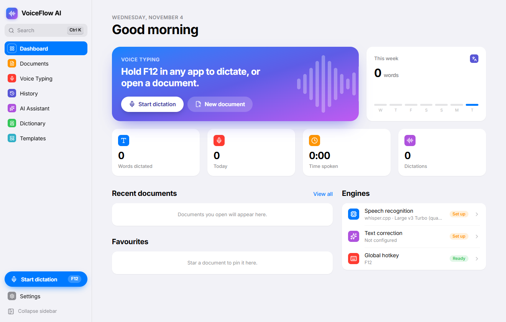
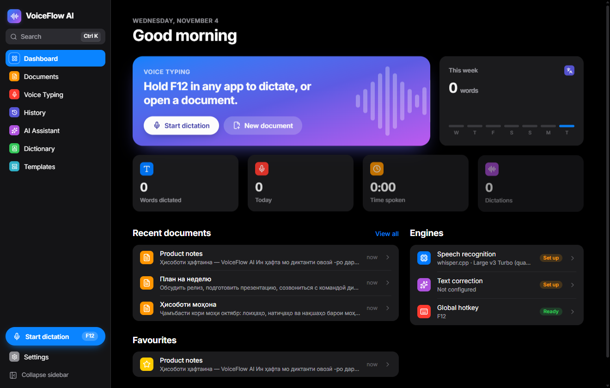
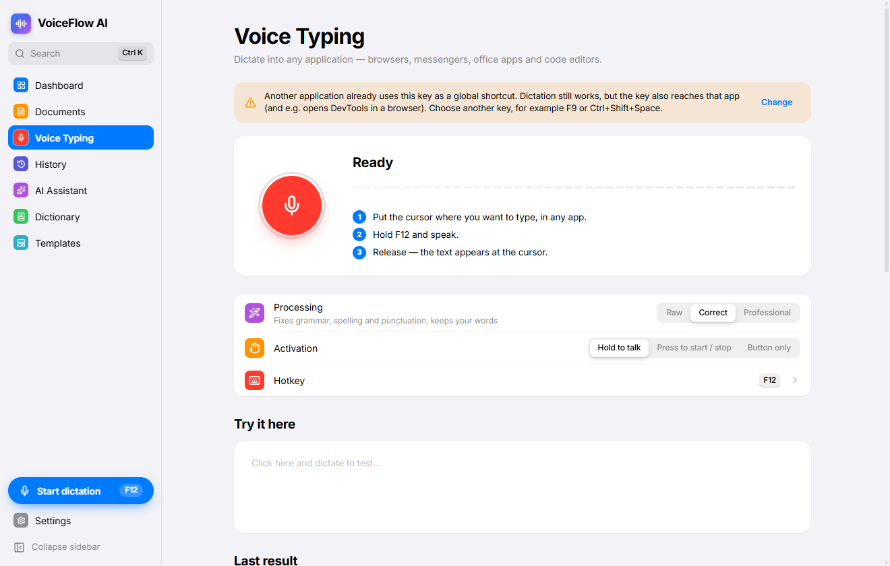
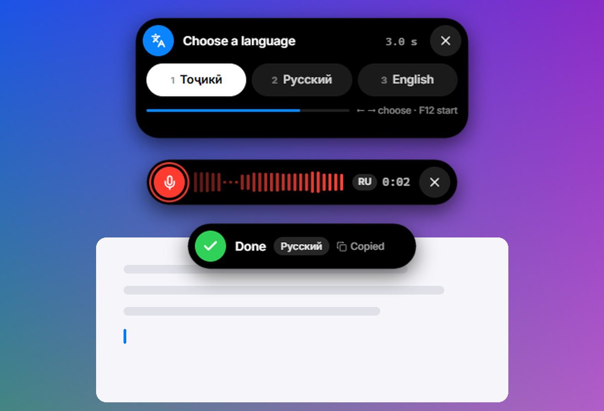
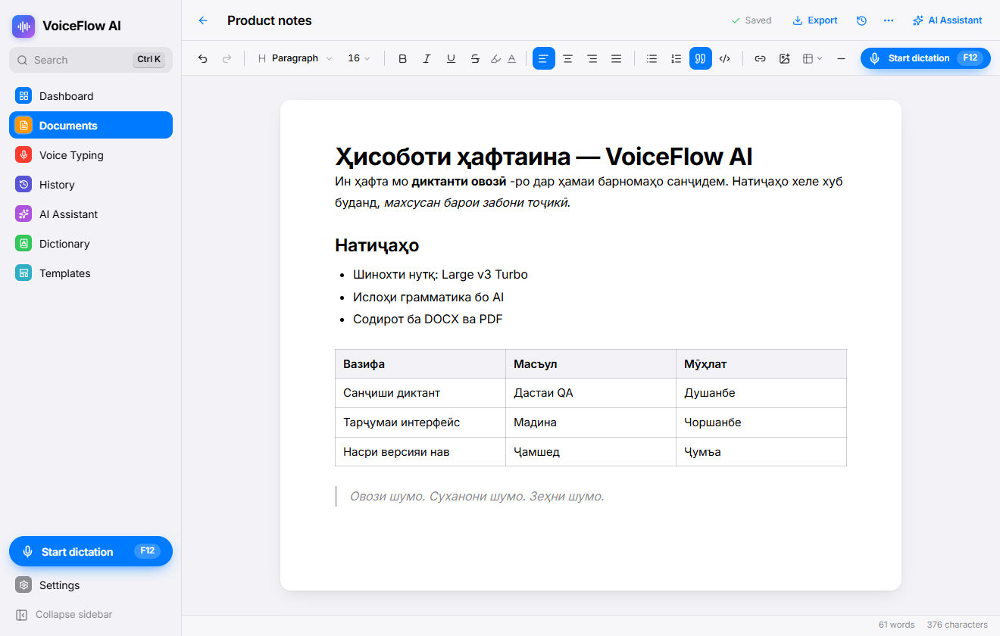
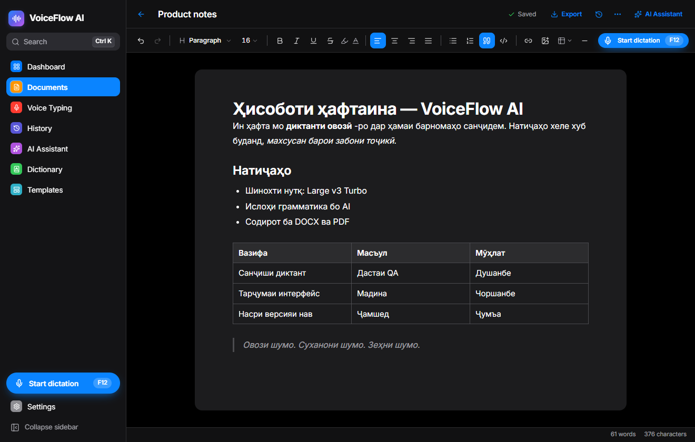

<p align="center">
  
</p>

<h1 align="center">VoiceFlow AI</h1>

<p align="center">
  <b>Your Voice. Your Words. Your Intelligence.</b><br />
  Voice typing in <b>any app</b> and an AI document workspace for <b>Windows</b> and <b>macOS</b> —
  in Tajik, Russian, English and dozens of other languages. Private by default: recognition runs on your computer.
</p>

<p align="center">
  <a href="https://github.com/imomzoda-dev/VoiceFlowAI/releases/latest"></a>
  
  
  <a href="https://github.com/imomzoda-dev/VoiceFlowAI/releases"></a>
</p>

<p align="center">
  <a href="https://github.com/imomzoda-dev/VoiceFlowAI/releases/latest"><b>⬇ Download for Windows</b></a> — <code>VoiceFlow-AI-Setup-&lt;version&gt;.exe</code>
  <br />
  <a href="https://github.com/imomzoda-dev/VoiceFlowAI/releases/latest"><b>⬇ Download for macOS</b></a> — <code>VoiceFlow-AI-&lt;version&gt;-arm64.dmg</code> (Apple Silicon) · <code>-x64.dmg</code> (Intel)
  <br /><br />
  <a href="README.ru.md">Русский</a> &nbsp;·&nbsp; <a href="CHANGELOG.md">What's new</a>
</p>

> [!IMPORTANT]
> **macOS: run one command before the first start.** After dragging the app into *Applications*, open **Terminal** and run:
>
> ```bash
> xattr -dr com.apple.quarantine "/Applications/VoiceFlow AI.app"
> ```
>
> Without it macOS refuses to open the app (*“cannot be opened”* or *“is damaged”*), because it is not signed with an Apple Developer ID. Once per installation is enough — in-app updates need nothing.

<p align="center">
  
  
</p>

## Hold a key. Speak. Release.

Put the cursor anywhere — Word, Google Docs, Telegram, WhatsApp, Chrome, Safari, VS Code, Notion, Outlook — hold the dictation key, speak, and let go. The text appears at the cursor, cleaned up the way you want.

- **Push-to-talk, toggle or button.** F12 by default on Windows, **Right Option (⌥)** on a Mac. Any key or combination, with conflict detection.
- **A Dynamic-Island widget** at the top of the screen shows the live waveform, timer, detected language and every step — and never steals focus from the app you're typing in.
- **Your clipboard is restored** after the text is pasted.

<p align="center">
  
  
</p>

## Choose the language with one key

Press **F12** (Right Option ⌥ on a Mac): the widget shows **your three languages**. Pick one with **← →** (or **1 2 3**) — after **2 seconds** (2–8 s, your choice) VoiceFlow AI starts listening in that language, or press the key again to start at once. Speech is recognised only in the languages you chose, so Russian never comes out as “Icelandic”.

**Types while you speak.** Like Google Docs voice typing, every phrase appears at the cursor as soon as you pause — while you keep talking. And the whole text also stays on the clipboard: if no text field had focus, just press **Ctrl+V / ⌘V**.

## Made for Tajik — and every other language

- **Automatic language detection**, or one language, or *“detect among Tajik, Russian, English”*. Whisper often labels Tajik as Russian or Persian; VoiceFlow AI checks the text for ғ қ ӯ ҳ ҷ ӣ and re-runs recognition in the right language.
- **Mixed speech stays mixed:** Russian terms inside Tajik sentences are kept, nothing is ever translated unless you ask.
- **Personal dictionary** for names, companies and terms — passed to the engine as hints and applied after recognition.

## Three ways to process what you said

| Mode | What it does |
|---|---|
| **Raw** | Exactly your words, basic clean-up only. No AI, nothing leaves your computer. |
| **Correct** | Grammar, spelling and punctuation fixed — your wording kept. Tajik orthography (имло, нуқтагузорӣ) included. |
| **Professional** | Polished, well-structured text with the same meaning — no invented facts. |

The original, the corrected and the final text are kept in **History** with a word-by-word comparison. If the AI is unavailable or changes too much, the original is inserted.

## A real document editor

<p align="center">
  
  
</p>

Headings, lists, tables, images, links, colours and highlights · dictation straight into the document · **voice commands** (*“new paragraph”*, *“новый абзац”*, *“абзаци нав”*, *“delete last sentence”*, *“translate to English”*…) · **AI assistant** that shows every change before applying it · automatic saving, crash recovery and version history · **DOCX, PDF, Markdown, TXT, HTML** export (Tajik letters included) and DOCX / Markdown import · 10 templates.

## Local first, cloud when you want it

| | |
|---|---|
| **On your computer** | [whisper.cpp](https://github.com/ggml-org/whisper.cpp) with models from 75 MB to 3 GB, downloaded only when you click and verified with SHA-256. Works offline. |
| **Your own API keys** | OpenAI, Groq, Anthropic, OpenRouter — or local Ollama, LM Studio and faster-whisper servers. Keys are encrypted with Windows DPAPI / macOS Keychain. |
| **Privacy switch** | No audio or text goes to the cloud until you allow it. Recordings aren't kept unless you turn that on. |

## Windows and macOS

| | Windows | macOS |
|---|---|---|
| Processors | x64 | Apple Silicon (M1–M5) and Intel |
| Install | `Setup-<version>.exe` | `.dmg`, drag to *Applications* |
| Default key | F12 | Right Option (⌥) |
| Updates | inside the app, SHA-512 checked | inside the app, SHA-512 and signature checked, the app replaces itself |
| Keys kept in | Windows DPAPI | macOS Keychain |
| Look | translucent sidebar, iOS-style controls | native vibrancy, ⌘ shortcuts, menu bar |

## Getting started

1. **Install** the app and open it — a short setup guides you through language, microphone, key and recognition.
2. **Speech engine** — *Settings → Recognition*:
   - Windows: click **Download whisper.cpp**.
   - macOS: `brew install whisper-cpp` (detected automatically, uses the Metal GPU).
3. **Model** — download **Large v3 Turbo (quantised)** (≈ 550 MB) for the best Tajik and Russian quality.
4. Optional: add an AI provider in *Settings → AI Providers* for *Correct* and *Professional* modes.
5. Hold your key in any app and speak.

**macOS permissions** (asked once, with an explanation): *Microphone*, *Accessibility* (to paste) and *Input Monitoring* (to notice the key).

**Windows:** the installer is not code-signed — if SmartScreen warns, click *More info → Run anyway*.

## Updates

VoiceFlow AI checks this page for new versions at start and every 4 hours. When one is out, an **Update** button appears in the sidebar: download → integrity check → **Restart and update**. Nothing is downloaded without your click; checks can be turned off in *Settings → About*.

---

<p align="center"><sub>© 2026 Imomzoda Mehriddin · <a href="LICENSE.txt">License</a> · Built with Electron, React, Tiptap and whisper.cpp</sub></p>
