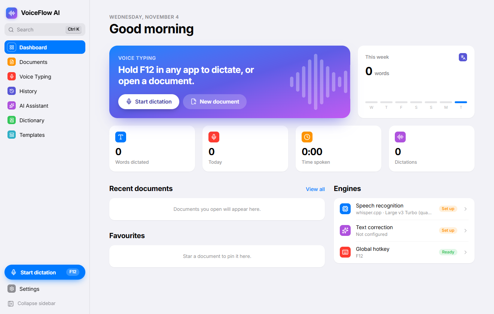
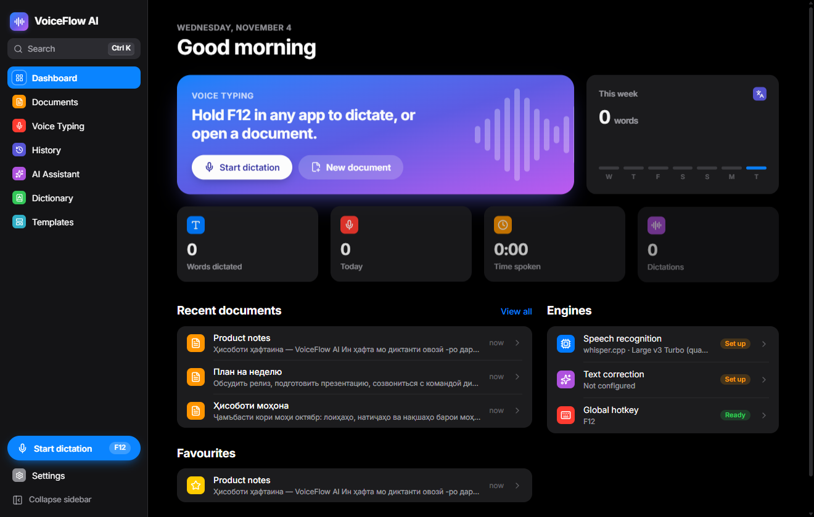
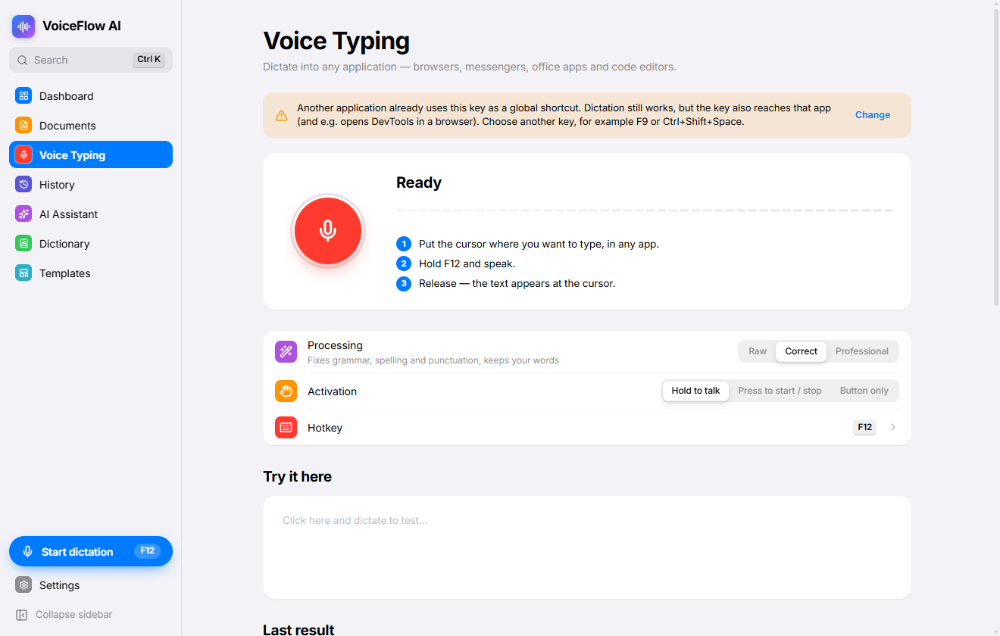
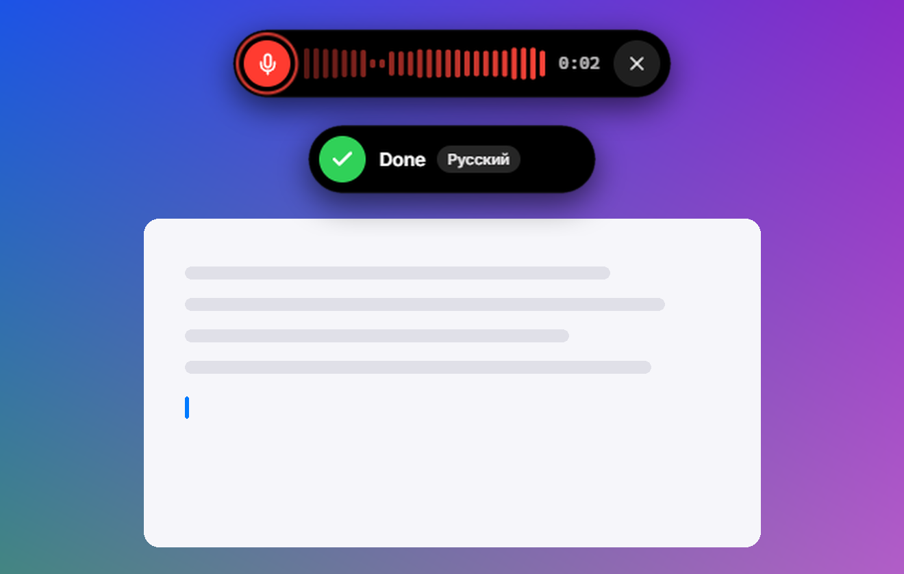
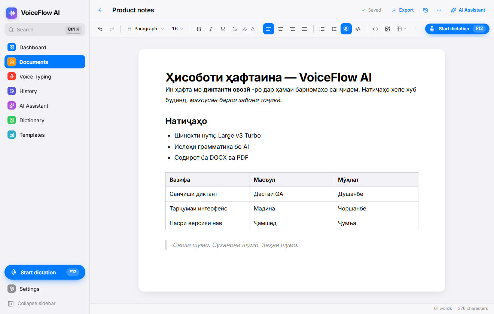
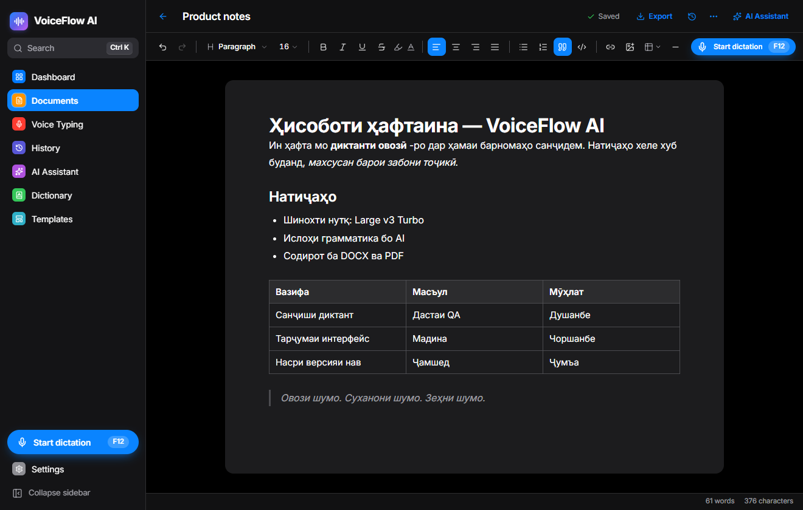

<p align="center">
  
</p>

<h1 align="center">VoiceFlow AI</h1>

<p align="center">
  <b>Ваш голос. Ваши слова. Ваш интеллект.</b><br />
  Голосовой ввод в <b>любом приложении</b> и AI-редактор документов для <b>Windows</b> и <b>macOS</b> —
  на таджикском, русском, английском и десятках других языков. Конфиденциально: распознавание работает на вашем компьютере.
</p>

<p align="center">
  <a href="https://github.com/imomzoda-dev/VoiceFlowAI/releases/latest"></a>
  
  
  <a href="https://github.com/imomzoda-dev/VoiceFlowAI/releases"></a>
</p>

<p align="center">
  <a href="https://github.com/imomzoda-dev/VoiceFlowAI/releases/latest"><b>⬇ Скачать для Windows</b></a> — <code>VoiceFlow-AI-Setup-&lt;версия&gt;.exe</code>
  <br />
  <a href="https://github.com/imomzoda-dev/VoiceFlowAI/releases/latest"><b>⬇ Скачать для macOS</b></a> — <code>VoiceFlow-AI-&lt;версия&gt;-arm64.dmg</code> (Apple Silicon) · <code>-x64.dmg</code> (Intel)
  <br /><br />
  <a href="README.md">English</a> &nbsp;·&nbsp; <a href="CHANGELOG.md">Что нового</a>
</p>

> [!IMPORTANT]
> **macOS: одна команда перед первым запуском.** Перетащите программу в «Программы», откройте **Терминал** и выполните:
>
> ```bash
> xattr -dr com.apple.quarantine "/Applications/VoiceFlow AI.app"
> ```
>
> Без этого macOS не откроет программу (*«не удаётся открыть»* или *«повреждена»*), потому что она не подписана Apple Developer ID. Один раз на установку — обновления внутри программы ничего не требуют.

<p align="center">
  
  
</p>

## Удерживайте клавишу. Говорите. Отпустите.

Поставьте курсор где угодно — Word, Google Docs, Telegram, WhatsApp, Chrome, Safari, VS Code, Notion, Outlook — удерживайте клавишу диктовки, говорите и отпустите. Текст появится в позиции курсора — в том виде, который вы выбрали.

- **Удержание, нажатие или кнопка.** По умолчанию F12 на Windows и **правый Option (⌥)** на Mac. Любая клавиша или сочетание, с проверкой конфликтов.
- **Виджет в стиле Dynamic Island** вверху экрана показывает звуковую волну, таймер, язык и каждый шаг — и никогда не забирает фокус у приложения, в котором вы пишете.
- **Буфер обмена восстанавливается** после вставки текста.

<p align="center">
  
  
</p>

## Создано для таджикского — и любых других языков

- **Автоопределение языка**, один язык или *«среди таджикского, русского и английского»*. Whisper часто принимает таджикскую речь за русскую или персидскую — VoiceFlow AI проверяет текст на ғ қ ӯ ҳ ҷ ӣ и повторяет распознавание на нужном языке.
- **Смешанная речь остаётся смешанной:** русские термины в таджикских предложениях сохраняются, без команды ничего не переводится.
- **Личный словарь** для имён, компаний и терминов — передаётся движку как подсказка и применяется после распознавания.

## Три режима обработки

| Режим | Что делает |
|---|---|
| **Без изменений** | Ровно ваши слова, минимальная очистка. Без AI, ничего не покидает компьютер. |
| **Исправление** | Грамматика, орфография и пунктуация — ваши формулировки сохраняются. Включая таджикское имло и нуқтагузорӣ. |
| **Профессиональный** | Грамотный, хорошо структурированный текст с тем же смыслом — без выдуманных фактов. |

Оригинал, исправленный и итоговый текст хранятся в **Истории** с пословным сравнением. Если AI недоступен или изменил слишком много — вставляется оригинал.

## Настоящий редактор документов

<p align="center">
  
  
</p>

Заголовки, списки, таблицы, изображения, ссылки, цвет и выделение · диктовка прямо в документ · **голосовые команды** (*«новый абзац»*, *«абзаци нав»*, *«удали последнее предложение»*, *«переведи на английский»*…) · **AI-ассистент**, который показывает каждое изменение перед применением · автосохранение, восстановление после сбоя и история версий · экспорт **DOCX, PDF, Markdown, TXT, HTML** (с таджикскими буквами) и импорт DOCX / Markdown · 10 шаблонов.

## Сначала локально, облако — по желанию

| | |
|---|---|
| **На вашем компьютере** | [whisper.cpp](https://github.com/ggml-org/whisper.cpp) с моделями от 75 МБ до 3 ГБ — загружаются только по кнопке и проверяются по SHA-256. Работает без интернета. |
| **Ваши API-ключи** | OpenAI, Groq, Anthropic, OpenRouter — или локальные Ollama, LM Studio и faster-whisper. Ключи шифруются Windows DPAPI / macOS Keychain. |
| **Переключатель приватности** | Ни аудио, ни текст не уходят в облако, пока вы не разрешите. Записи не хранятся, если вы этого не включили. |

## Windows и macOS

| | Windows | macOS |
|---|---|---|
| Процессоры | x64 | Apple Silicon (M1–M5) и Intel |
| Установка | `Setup-<версия>.exe` | `.dmg`, перетащить в «Программы» |
| Клавиша по умолчанию | F12 | правый Option (⌥) |
| Обновления | внутри программы, проверка SHA-512 | внутри программы, проверка SHA-512 и подписи, программа заменяет себя сама |
| Ключи хранятся в | Windows DPAPI | macOS Keychain |

## Начало работы

1. **Установите** программу и откройте её — короткая настройка проведёт через язык, микрофон, клавишу и распознавание.
2. **Движок речи** — *Настройки → Распознавание*:
   - Windows: нажмите **Загрузить whisper.cpp**.
   - macOS: `brew install whisper-cpp` (находится автоматически, использует GPU Metal).
3. **Модель** — загрузите **Large v3 Turbo (quantised)** (≈ 550 МБ) для лучшего качества таджикского и русского.
4. По желанию: добавьте AI-провайдера в *Настройки → AI-провайдеры* для режимов «Исправление» и «Профессиональный».
5. Удерживайте клавишу в любом приложении и говорите.

**Разрешения macOS** (запрашиваются один раз, с объяснением): *Микрофон*, *Универсальный доступ* (для вставки) и *Мониторинг ввода* (для клавиши).

**Windows:** установщик не подписан — если SmartScreen предупредит, нажмите «Подробнее → Выполнить в любом случае».

## Обновления

VoiceFlow AI проверяет эту страницу при запуске и каждые 4 часа. Когда выходит новая версия, в боковой панели появляется кнопка **«Обновить»**: загрузка → проверка целостности → **«Перезапустить и обновить»**. Без вашего нажатия ничего не загружается; проверку можно отключить в *Настройки → О программе*.

---

<p align="center"><sub>© 2026 Imomzoda Mehriddin · <a href="LICENSE.txt">Лицензия</a> · Electron, React, Tiptap и whisper.cpp</sub></p>
